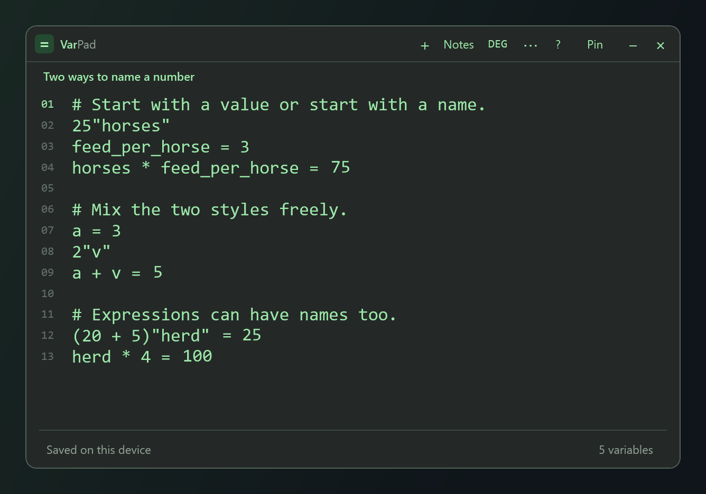
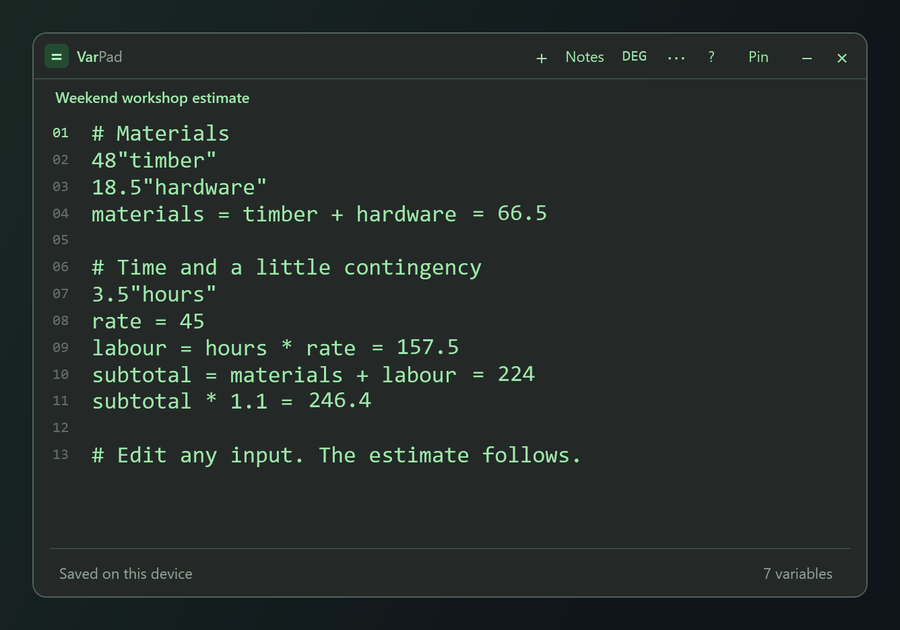
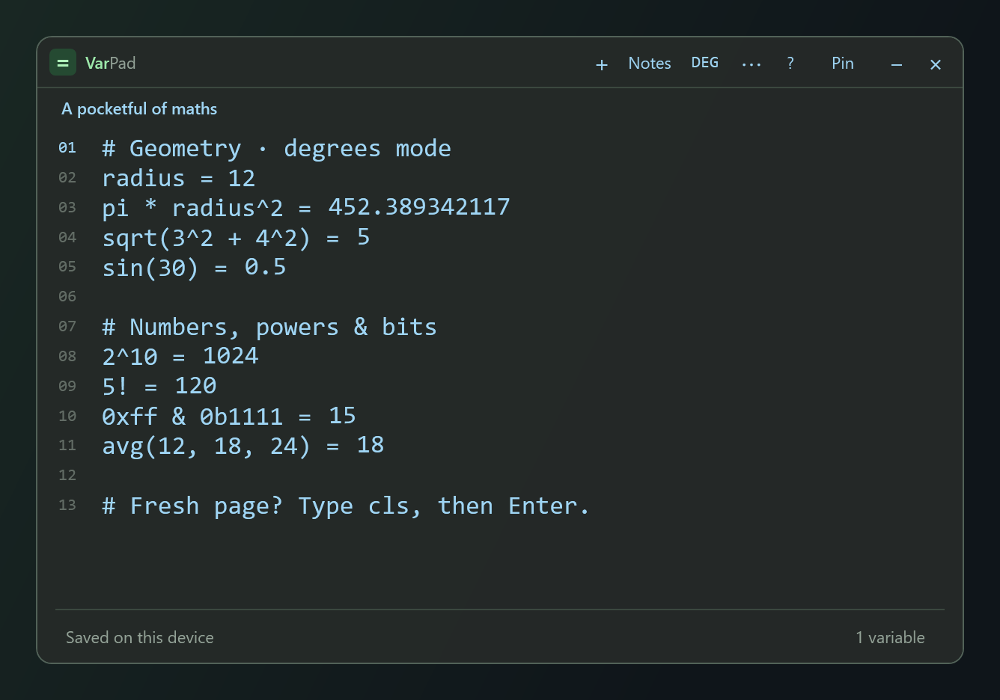

# VarPad

**Name a number. Keep your train of thought.**

A tiny Windows notepad calculator with named variables, live inline answers, and a translucent desktop window. Write the calculation as you think it. No keypad, account, or internet connection required.

[Download the Windows installer](https://github.com/loetech1/VarPad/releases/latest/download/VarPad-Setup.exe) · [Portable ZIP](https://github.com/loetech1/VarPad/releases/latest/download/VarPad-Portable.zip) · [Quick reference](src/Help.txt)



## Two ways to name a number

```text
horses = 25
```

Or put the name after the value:

```text
25"horses"
feed_per_horse = 3
horses * feed_per_horse =
```

The last line displays **75** immediately after `=`. Change the number of horses and the answer updates. Both styles can be mixed freely, and expressions work too: `(20 + 5)"herd"`.

Quoted names also work inside calculations:

```text
3"teabage" + 2 =       # 5; teabage is 3
teabage * 4 =         # 12
3"tea" + 2"sugar" =   # 5; defines both variables
(3 + 2)"total" =      # total is 5
```

A quoted name binds the preceding value; parentheses name a whole calculation. Signs and powers bind before the quoted name, multiplication and addition after it. Bindings can be reused later in the same expression and on following lines. Failed lines do not save partial bindings and invalidate attempted reassignments.

Names ignore case, start with a letter or `_`, and can contain letters, digits and underscores. Variables belong to their note and evaluate from top to bottom. Constants such as `pi` and `e`, and the previous-result name `ans`, are reserved. Straight or curly double quotes work; names containing spaces are not supported.

## A scratchpad for everyday maths



- **Answers where you write.** Live results appear inline, with no separate answer column. Click a generated answer to copy it.
- **Readable large numbers.** Inputs, answers and variable values automatically show thousands separators, such as `123,456,789`. Input grouping marks occupy a full character cell for clear spacing. They are distinct from typed argument commas and are removed when saving, exporting or copying. Type numbers without grouping commas; typed commas still separate function arguments. Copied numbers omit visual grouping so they paste safely into formulas.
- **A small desktop companion.** Compact toolbar, always on top, 6-pixel scrollbars and adjustable text size.
- **Your preferred look.** Green text on charcoal by default; dark, light, amber and blue themes. Adjust background opacity while keeping text opaque.
- **Notes that stay.** Multiple windows, local autosave, backup recovery, rename, duplicate, delete, import and export.
- **Wrap long lines.** Choose **⋯ → Wrap text** to fit text to the window. This preference saves per note. Calculations stay on one logical line, with answers at the end.
- **Complete names with Tab.** Start typing a variable, constant or function, use Up/Down to choose a suggestion, then press Tab. Functions insert parentheses with the cursor inside. Ctrl+Space opens suggestions; Esc dismisses them. Enter still starts a new line. With no match, Tab keeps its normal indentation behaviour.
- **Start fresh quickly.** Type `cls` or `clear` on its own line and press Enter. Ctrl+Z restores the cleared note.
- **Useful maths built in.** Powers, roots, factorials, rounding, logs, trigonometry, aggregates, bitwise operators and binary/hexadecimal numbers.



These images are captured from the real WPF view using demonstration notes. Regenerate them with `scripts/screenshots.ps1`.

## Install

Download **VarPad-Setup.exe** from [Releases](https://github.com/loetech1/VarPad/releases/latest), run it, and select **Install VarPad**. It installs for your Windows account, adds a Start menu shortcut, and offers a desktop shortcut. No administrator access is needed. Remove it through **Windows Settings → Apps**.

For a standalone copy, extract **VarPad-Portable.zip** and run **VarPad.exe**. Keep `VarPad.exe.config` beside it. Portable means installation-free; notes are still stored in your Windows profile.

**Requires Windows 10 or 11 with .NET Framework 4.8 or later.** No Node.js, Python or WebView runtime is required to run the app. Releases are currently unsigned.

## Keyboard shortcuts

| Shortcut | Action |
| --- | --- |
| Tab / Up / Down | Complete a name / choose a suggestion |
| Ctrl+Space / Esc | Show / dismiss suggestions |
| Ctrl+N | New note |
| Ctrl+O / Ctrl+S | Import / export text |
| Ctrl+Shift+C | Copy the current line's result |
| Ctrl+Shift+P | Toggle always on top |
| Ctrl++ / Ctrl+- | Change text size |
| Ctrl+Z / Ctrl+Y | Undo / redo |
| Ctrl+W | Close a window, keeping its note |
| Ctrl+Q | Quit and restore open notes on next launch |
| F1 | Functions and syntax reference |

The **Notes** menu reopens saved notes. To delete one permanently, open it, choose **Notes → Delete this note…**, and confirm. This removes the note and its backup; it cannot be undone. Closing a window with **×** still keeps its note saved. **⋯** opens theme, font and opacity settings.

## How calculations behave

- `#` and `//` begin comments. Use `#` for a memo containing numbers or operators.
- `%` means remainder; use `amount * percent / 100` for percentages.
- `^` means power; `xor` means bitwise XOR.
- `ans` is the previous successful result in the note. Forward variable references are not supported.
- Generated answers are displayed without becoming part of your editable input. Text exports contain your expressions; click a result or use Ctrl+Shift+C to copy a calculated answer.
- You can write an expected answer, such as `a + v = 5`. A mismatch displays the actual result.
- Calculations use IEEE 754 doubles (about 15 significant digits); answers display 12 significant digits. Bitwise operations require exact integers with magnitude at most 2^53−1. This is not a symbolic or arbitrary-precision solver.

See the [complete reference](src/Help.txt) for functions and examples.

## Your notes and the rename

VarPad was originally called **StickierCalc**. On first launch it copies any old notes and backups from `%LOCALAPPDATA%\StickierCalc\Notes` into `%LOCALAPPDATA%\VarPad\Notes`. Originals are left untouched; subsequent edits belong to VarPad. The old app can remain installed independently.

Back up `%LOCALAPPDATA%\VarPad\Notes` to preserve all notes and preferences. Uninstalling keeps this folder. Program files live in `%LOCALAPPDATA%\Programs\VarPad`.

## Build from source

The build uses the C# compiler that ships with .NET Framework; no NuGet downloads or separate SDK installation is needed. In Windows PowerShell, from the repository folder:

```powershell
# Build the app and run calculation/persistence tests
powershell -NoProfile -ExecutionPolicy Bypass -File .\scripts\build.ps1

# Verify the real WPF layout, inline answers, scrolling and clear commands
powershell -NoProfile -ExecutionPolicy Bypass -File .\scripts\test-layout.ps1

# Package and check the installer
powershell -NoProfile -ExecutionPolicy Bypass -File .\scripts\build.ps1 -Installer
powershell -NoProfile -ExecutionPolicy Bypass -File .\scripts\test-installer.ps1

# Regenerate the README screenshots
powershell -NoProfile -ExecutionPolicy Bypass -File .\scripts\screenshots.ps1
```

Outputs go in `dist/`. Add `-OutputDirectory dist\v1.3.0` to the build and installer-test commands to use a separate release directory. The execution-policy flag applies only to that build process; it does not change Windows settings. Tests use temporary data under `build/`, not your notes, shortcuts or registry.

| Source | Purpose |
| --- | --- |
| `src/Calculator.cs` | Bounded expression parser and variable bindings |
| `src/InlineAnswer.cs` | Inline result formatting |
| `src/App.cs`, `src/MainWindow.xaml` | Native WPF app and editor |
| `src/Storage.cs` | Atomic saves, backup recovery and legacy import |
| `installer/Setup.cs` | Per-user installer and uninstaller |
| `tests/` | Calculation, persistence and WPF checks; screenshot capture |

## Credits and license

An independent implementation inspired by the compact notepad workflow of [Sticky Calculator for Windows by Life Code](https://apps.microsoft.com/detail/9nblggh4svpt). No original source code or artwork is used. Exact syntax compatibility with every version of that app is not claimed.

Released under the [MIT License](LICENSE). Contributions and reproducible bug reports are welcome.
